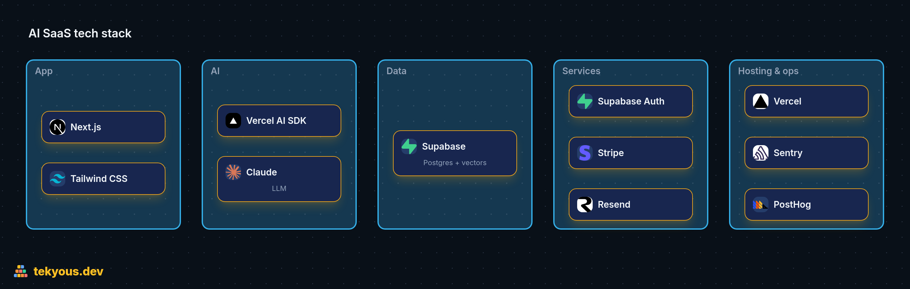

# Tekyous agent skills: tech stack diagrams and recommendations for AI agents

Skills and plugins that bring [Tekyous](https://tekyous.dev?utm_source=github&utm_medium=readme), the tech stack
builder and developer tools catalogue, into your coding agent:

- **`tech-stack-recommendation`**: ask which stack or tools to use, and the agent answers from Tekyous's curated
  stacks and tools catalogue (scores, pricing, pros and cons, trade-offs), checked against your project's constraints.
- **`tech-stack-diagram`**: ask the agent to draw your project's tech stack. It reads the repository, draws the tools
  with their logos, saves the picture and adds it to your README. The picture links to the same diagram in the
  [Tekyous stack builder](https://tekyous.dev/builder?utm_source=github&utm_medium=readme), fully editable.

They come as a **Claude Code plugin** and as **skills** for any agent with a shell. Both use the free
[Tekyous MCP server](https://tekyous.dev/mcp?utm_source=github&utm_medium=readme), which needs no sign-in and no API
key.

[](https://tekyous.dev/builder?utm_source=github&utm_medium=readme#doc=v1.bZJBb4MwDIX_CvJ1cNiVWydN2qROmtTjxMENLs0akiw2bKjivy-0lIZpx5jn9z7bnOHgQosCJQidBtdxUWtsAraQQ0-BtbNQPuYgWgxF1eY12yHuMiF1zFhQnaKwCa7zDOXHGXQdReg9JC2Xl3LGhfji0zB9c85MDWDpRz55qqA239rWivkarcgUqAuuY8IZ2HRN7L7WJzv0cmGDF8eibQNjNeZz_j5ika0ThqelcuOglgKaOmFZQrjzuEemVcx7jGkCcfaQ9aTEBYYxX6QFdnJMOJXBrl4bbLdvKSNT6LUiTiB399KNstfOkPwLKUH7P4g4tGRlAltkkXiee5E9t3HVqcbH0Y6uWYk2Fs0gWq3MopWEYW0WwmUV1VhN1NbOu5lID8G197_BrQ5jcB_vWMJXR0ET55mPYj-zz43JGd16Y7du6q_zVuMv)

*An AI SaaS stack drawn by the Tekyous MCP server. Click it to open the diagram in the builder and edit it.*

## Install

Pick one. Then ask, for example:
- **"Draw this project's tech stack, save the image into the repo and add it to the README."**
- **"I'm building a booking app for yoga studios and know some Python. What stack should I use?"**

### Claude Code: the plugin

```
/plugin marketplace add tekyous/agent-skills
/plugin install tekyous@tekyous
```

It adds the Tekyous MCP server and both skills. They start by themselves when you ask for a stack or a diagram, or
run them as `/tekyous:tech-stack-recommendation` and `/tekyous:tech-stack-diagram`. Grok Build installs the same plugin:
`grok plugin install tekyous/agent-skills`.

### Any agent with skills: the skills

```bash
npx skills add tekyous/agent-skills
```

Or copy the folders in [`skills/`](skills) into your agent's skills folder:

| Agent | Project folder | User folder |
|---|---|---|
| Claude Code | `.claude/skills/` | `~/.claude/skills/` |
| Codex | `.agents/skills/` | `~/.agents/skills/` |
| Cursor | `.agents/skills/` or `.cursor/skills/` | `~/.cursor/skills/` |
| GitHub Copilot | `.agents/skills/` | `~/.copilot/skills/` |
| Antigravity | `.agents/skills/` | `~/.gemini/config/skills/` |
| Grok Build | `.grok/skills/` | `~/.grok/skills/` |
| Z Code | `.zcode/skills/` | `~/.zcode/skills/` |
| Cline | `.agents/skills/` | `~/.agents/skills/` |
| OpenCode | `.agents/skills/` | `~/.config/opencode/skills/` |
| Kilo Code | `.agents/skills/` | `~/.kilo/skills/` |
| Qwen Code | `.qwen/skills/` | `~/.qwen/skills/` |
| Kiro CLI | `.kiro/skills/` | `~/.kiro/skills/` |

Many agents also read the shared `.agents/skills/` folder, and `npx skills add` knows more than 75 of them.

The skills work with or without the MCP server connected (see [How it works](#how-it-works)).

### Any MCP client: the server only

[](https://glama.ai/mcp/connectors/dev.tekyous/tekyous)

Add `https://mcp.tekyous.dev/mcp` as a remote (streamable HTTP) MCP server. Setup for Claude, Cursor, VS Code with
GitHub Copilot, Codex, Antigravity, Grok Build, Z Code and other agents: [tekyous.dev/mcp](https://tekyous.dev/mcp?utm_source=github&utm_medium=readme#setup).

```bash
claude mcp add --transport http --scope user tekyous https://mcp.tekyous.dev/mcp   # Claude Code
codex mcp add tekyous --url https://mcp.tekyous.dev/mcp                             # Codex
```

## How it works

### `tech-stack-recommendation`

The skill asks for what's missing (the kind of project, your experience, the constraints), asks Tekyous for its
recommendation (`recommend_stack`) and the finalists' profiles (`get_tool`, `search_tools`), and answers with a short
table: the pick per role, why it fits, its pricing and its main trade-off. It then offers a diagram of the result.

**Tekyous grounds the answer; the agent decides.** Tekyous's recommendation follows the rules of its questionnaire for a
project type and an experience level, and the catalogue doesn't list every tool. The skill tells the agent to check
that the picks fit together and fit your constraints, to recommend a better tool even when Tekyous doesn't list it,
and to say where and why it departs from Tekyous's pick.

It calls the MCP tools when they're connected and the same server over curl when they aren't. Without network it
can't check the catalogue, and says so.

### `tech-stack-diagram`

The skill reads the project's manifests and config (`package.json`, `pyproject.toml`, `requirements.txt`,
`Dockerfile`, `docker-compose.yml`, CI workflows, the README). It writes a small diagram spec: the tools, in a few
groups by role. Then it draws the spec by the first route that works:

1. **The MCP tools, when the Tekyous server is connected** (the plugin connects it). The agent looks tools up in the
   catalogue with `search_tools` and draws with `compose_diagram`.
2. **curl, when it isn't.** The same server, called over plain HTTPS: no key, no session, the same picture.
3. **An offline link, when there is no network** (Codex blocks network for shell commands by default). A local
   script encodes the spec into a `tekyous.dev/builder#doc=…` link. You open it and export the image in the builder.

Each route ends with a PNG (or, offline, the link) and a README snippet whose picture links to the editable diagram.
The server checks the spec against the Tekyous catalogue: it suggests catalogue slugs for tools drawn as custom ones
and warns about missing pieces or tools that conflict. The agent fixes what it can and draws again.

Tekyous draws a **tech stack**: the tools a project uses and, if you ask, how they connect. It does not draw code
structure, C4 levels, sequence or entity-relationship diagrams.

## What is sent, and where

- **Sent:** for a diagram, the spec only: tool names, group titles, captions, notes and connector labels. For a
  recommendation, the project type, experience level, language and the tools looked up. Never file contents,
  environment values or credentials. The skills tell the agent not to open `.env` files or keys.
- **To:** `mcp.tekyous.dev` (the server) and `img.tekyous.dev` (the image). The offline route sends nothing.
- **Stored:** images for 30 days. The diagram itself lives in its link, which anyone holding it can open, so keep
  anything private out of names and notes. Calls are logged without IP addresses for 90 days.
  Details: [tekyous.dev/privacy](https://tekyous.dev/privacy#mcp-server).
- **Not done:** no API key, no account, no install hooks, no downloaded code run. The only script is
  [`doc_link.py`](skills/tech-stack-diagram/scripts/doc_link.py), the offline encoder (Python standard library).

## What's in this repository

| Path | What it is |
|---|---|
| `skills/tech-stack-recommendation/` | The recommendation skill |
| `skills/tech-stack-diagram/` | The diagram skill: `SKILL.md`, the spec guidance and the offline encoder |
| `.claude-plugin/` | The Claude Code plugin (`plugin.json`) and this repository as its marketplace (`marketplace.json`) |
| `.mcp.json` | The plugin's connection to the Tekyous MCP server |
| `server.json` | The server's entry in the [MCP Registry](https://registry.modelcontextprotocol.io), which Glama and other directories copy |
| `glama.json` | Names this repository's maintainers on [Glama](https://glama.ai) |
| `.github/scripts/sync_design_stack.py` | Copies the server's `design_stack` prompt into the skill, so both give the same guidance |
| `tests/` | Checks the offline links match the server's own byte for byte |

The Tekyous MCP server itself, the catalogue and the renderer are not open source. This repository holds only the
packaging and the instructions, under the MIT licence.

## Development

```bash
python3 -m unittest discover tests            # offline links match the server's encoder
python3 .github/scripts/sync_design_stack.py --check  # the skill's guidance matches the live prompt
claude plugin validate .                      # the marketplace and plugin manifests
```

After the server's `design_stack` prompt changes, run `python3 .github/scripts/sync_design_stack.py` and commit the result.

Something broke, or an agent drew or recommended something odd? Open an issue or write to
[contact@tekyous.dev](mailto:contact@tekyous.dev).
